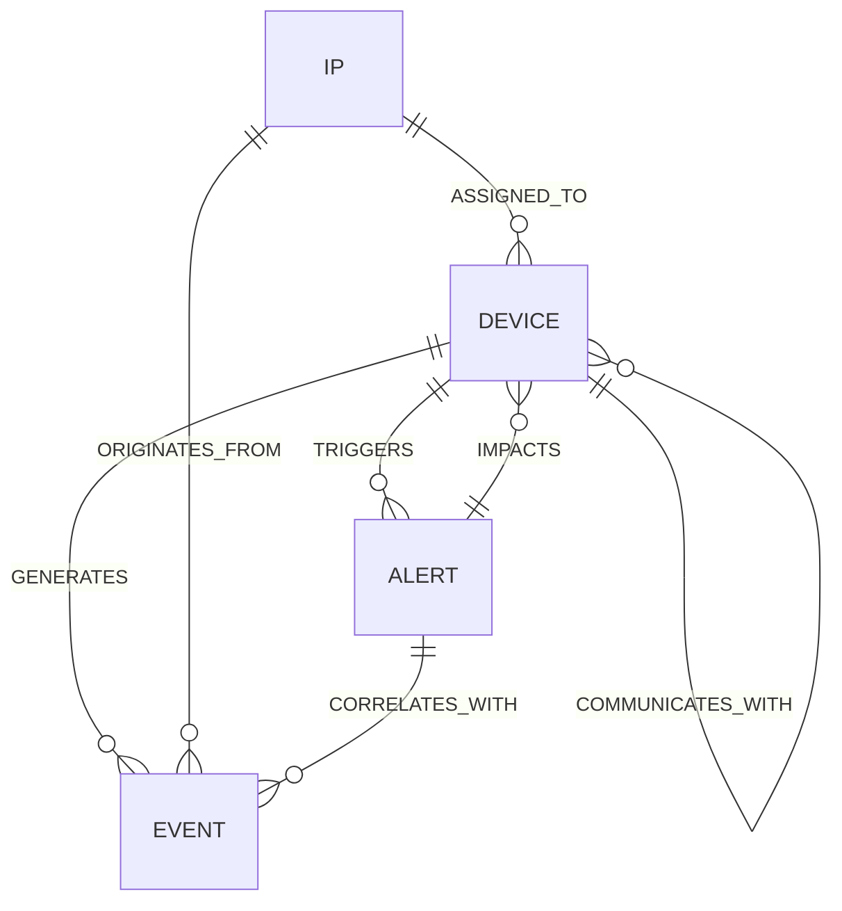

# Telemetrie IoT/IIoT sub Atac: Sistem Inteligent de Audit și Corelare Industrială

Barieră inteligentă de securitate la nivel de aplicație și proces industrial, concepută pentru a monitoriza telemetria generată de dispozitive IoT/IIoT, a corela anomaliile fizice cu jurnalele de sistem (OS logs) în timp real și a investiga campaniile complexe de atac cibernetic.

Proiectul utilizează setul de date **TON_IoT** și integrează un pipeline hibrid compus dintr-o rețea de brokeraj MQTT unificat, persistență duală (serii temporale prin InfluxDB și grafuri de evenimente prin Neo4j) și un modul agentic bazat pe **GraphRAG** și **Model Context Protocol (MCP)** pentru audit și investigații forenzice în limbaj natural.

---

## 1. Vectori de Atac și Telemetrie Monitorizată

Platforma mapează telemetria și jurnalele celor 7 clase de dispozitive pe o structură ierarhică de topicuri MQTT: `fabrica/{dispozitiv}/{canal}`.

| Dispozitiv | Topic Telemetrie | Topic Jurnale OS | Măsurători & Tip Date | Amenințări Simulate (TON_IoT) |
| :--- | :--- | :--- | :--- | :--- |
| **PLC Modbus** | `fabrica/modbus/telemetrie` | `fabrica/modbus/logs` | Registre holding/coils (Discrete / Int) | *Command Injection*, *Scanning*, *Modbus Tampering* |
| **Frigider Industrial** | `fabrica/frigider/telemetrie` | `fabrica/frigider/logs` | Temperatură (°C), stare compresor (0/1) | *Brute Force SSH*, *Data Spoofing*, *DoS* |
| **Termostat Zonă** | `fabrica/termostat/telemetrie` | `fabrica/termostat/logs` | Temperatură ambiantă (°C), stare releu | *False Data Injection (FDI)*, *MitM* |
| **Acces Garaj / Cargo** | `fabrica/garaj/telemetrie` | `fabrica/garaj/logs` | Stare binară (`open` / `closed`) | *Unauthorized Actuation*, *Replay Attack* |
| **Senzor Mișcare & Lumină** | `fabrica/lumina/telemetrie` | `fabrica/lumina/logs` | Iluminare (Lux), stare PIR (`active` / `idle`) | *Physical Intrusion Evasion*, *DoS* |
| **Stație Meteo** | `fabrica/meteo/telemetrie` | `fabrica/meteo/logs` | Umiditate (%), presiune (hPa), vânt (m/s) | *Reconnaissance*, *Sensor Hijacking* |
| **Receptor GPS Logistic** | `fabrica/gps/telemetrie` | `fabrica/gps/logs` | Coordonate NMEA (Latitudine / Longitudine) | *GPS Spoofing*, *Ransomware Vector* |

---

## 2. Topologie Hardware & Niveluri Arhitecturale

Sistemul adoptă o topologie distribuită pe 3 niveluri fizice:

```
                  [ NIVEL EDGE: Dispozitive & Senzori ]
                    ┌─────────────────────────────────┐
                    │  Raspberry Pi #2 & Pi #3        │
                    │  • Replay telemetrie (P1)       │
                    │  • OS Log Shipper (P2)          │
                    │  • Sincronizare ceas virtual    │
                    └────────────────┬────────────────┘
                                     │ MQTT peste TLS / TCP (Port 1883/8883)
                                     ▼
             [ NIVEL CENTRAL: Ingestie, Stocare & Servicii MCP ]
                    ┌─────────────────────────────────────────┐
                    │  Server Linux OCI (Min. 4 GB - 24 GB)   │
                    │  • Mosquitto MQTT Broker (Port 1883)    │
                    │  • Industrial Gateway & Detector (P3)   │
                    │  • Storage Pipeline Manager (P4)        │
                    │    ├─ InfluxDB v2 (Serii temporale)     │
                    │    └─ Neo4j Enterprise/Community (Graph)│
                    │  • Server MCP (Context & Tools Agentic) │
                    └────────────────┬────────────────────────┘
                                     │ WebSockets / REST API / MCP Protocol (SSE/stdio)
                                     ▼
                   [ NIVEL SOC: Consola Administratorului ]
                    ┌─────────────────────────────────┐
                    │  Laptop Administrator           │
                    │  • Audit Dashboard (P5)         │
                    │  • Streamlit UI + MCP Client    │
                    │  • Asistent LLM (GraphRAG)      │
                    └─────────────────────────────────┘
```

### Specificații de Dimensionare Hardware

| Nivel Arhitectural | Nod Hardware Recomandat | Cerințe Resurse | Rol & Responsabilități |
| :--- | :--- | :--- | :--- |
| **Nivel Edge** | 2x Raspberry Pi (3B+, 4 sau Zero 2W) | 1 GB RAM, Raspbian OS / Debian | Rulează `telemetry_replay.py` și `os_log_shipper.py` cu generator de timp virtual calibrat pe datele TON_IoT. |
| **Nivel Central** | VM Linux (ex. Oracle Cloud OCI Ampere A1 sau VM Dedicat) | Min. 4–8 GB RAM, 2–4 vCPU, 50 GB SSD | Mosquitto, InfluxDB, Neo4j (JVM heap $\ge 2$ GB), Ingestie FastAPI și Server MCP. |
| **Nivel SOC** | Laptop / Stație Administrator | 8 GB RAM, Browser Web, Python 3.11+ | Găzduiește Streamlit Dashboard (`audit_dashboard.py`), clientul MCP și interfața de dialog LLM. |

---

## 3. Fluxul de Prelucrare și Pipeline-ul de Ingestie

```
[ 7 Dispozitive IoT/IIoT ] (Raspberry Pi #2 / #3)
            │
            ▼ (Publicare MQTT Unificată: fabrica/{dispozitiv}/{telemetrie|logs})
[ 1. Broker Mosquitto & Recepție Asincronă ]
            │
            ▼ (Async Consumer - `aiomqtt` / `asyncio`)
[ 2. Parser & Validare Schemă Pydantic ] (industrial_gateway.py)
            │
            ▼ (Sliding Window & Z-score / Praguri Semantice)
[ 3. Motor Detecție Preliminară Anomalii ]
            │
      ┌─────┴────────────────────────────────┐
      ▼ (Async Worker Queue)                 ▼ (Async Worker Queue)
[ 4A. Telemetrie / Serii Temporale ]  [ 4B. Topologie Relațională & Cauzalitate ]
      │                                      │
      ▼                                      ▼
  InfluxDB (TSDB)                        Neo4j (Knowledge Graph)
  • Bucket: `telemetrie_iot`             • Noduri: Device, Event, IP, Alert
  • Puncte float/int, tag-uri dispozitiv • Relații: COMMUNICATES_WITH, TRIGGERED_BY
  • Rezoluție la nivel de milisecunde    • Reconstituire căi de atac lateral
```

### Principii de Operare:
1. **Transport Unificat pe MQTT:** Elimină fragilitatea socket-urilor TCP brute pentru loguri; atât telemetria fizică, cât și evenimentele OS (`auth.log`, `syslog`) sunt transmise ca payload-uri JSON structurate pe topicuri dedicate, garantând QoS 1, buffering local și reconectare automată.
2. **Sincronizare cu Ceas Virtual (Timeline Synchronization):** Generatorul calculează un offset temporal uniform raportat la timpul de start al simulării:
   $$t_{\text{emis}} = T_{\text{start}} + \alpha \cdot (t_{\text{dataset}} - t_0)$$
   unde $\alpha$ este factorul de accelerație a redării (ex. $1.0\times$ pentru timp real). Astfel, atacurile OS (SSH Brute Force) și deviațiile senzorilor fizici coincid exact în baza de date.
3. **Pipeline Decuplat Asincron (P3 $\rightarrow$ P4):** Gateway-ul (`industrial_gateway.py`) preia mesajele, le validează asincron prin Pydantic și le distribuie către `storage_manager.py` printr-o coadă internă `asyncio.Queue`, prevenind blocarea buclei de evenimente la scrieri masive.

---

## 4. Ontologia Grafului de Securitate (Neo4j)

Pentru a asigura acuratețea algoritmilor GraphRAG, schema relațională este strict structurată:



### Proprietăți Cheie ale Entităților:
* **`(:Device)`**: `id`, `name`, `type`, `ip_address`, `zone`, `criticality`
* **`(:Event)`**: `event_id`, `timestamp`, `source`, `type` (`telemetry_deviation`, `auth_failure`, `scan`, `coil_write`), `raw_payload`
* **`(:Alert)`**: `alert_id`, `timestamp`, `severity` (`LOW`, `MEDIUM`, `HIGH`, `CRITICAL`), `rule`, `resolved`
* **`(:IP)`**: `address`, `subnet`, `is_external`, `reputation`

---

## 5. Structura Proceselor Software (Python)

Sistemul este organizat în 5 module specializate:

| ID | Modul / Fișier | Nod Gazdă | Tehnologii Cheie | Descriere Funcțională |
| :--- | :--- | :--- | :--- | :--- |
| **P1** | `telemetry_replay.py` | Raspberry Pi #2 & #3 | `paho-mqtt`, `asyncio`, `pandas` / `csv` | Încarcă subseturile CSV din TON_IoT și transmite asincron telemetria fizică etichetată sincronizată temporal. |
| **P2** | `os_log_shipper.py` | Raspberry Pi #2 & #3 | `paho-mqtt`, `watchdog`, `json` | **Mod dual:** (1) Replay sincronizat din jurnalele TON_IoT Linux și (2) monitor live `/var/log` către topicul `fabrica/{dev}/logs`. |
| **P3** | `industrial_gateway.py` | Server Linux OCI / VM | `FastAPI`, `aiomqtt`, `Pydantic` | Ingestie non-blocantă din brokerul MQTT, validare scheme Pydantic și calcul deviații pe ferestre glisante. |
| **P4** | `storage_manager.py` | Server Linux OCI / VM | `influxdb-client`, `neo4j`, `asyncio` | Serviciu asincron consumator din P3: scriere serii temporale în InfluxDB și actualizare tranzacțională a grafului Neo4j. |
| **P5** | `audit_dashboard.py` | Laptop Administrator | `Streamlit`, `Plotly`, `mcp-client` | Interfață analitică SOC: grafice live InfluxDB, vizualizare topologie Neo4j și consolă LLM integrată prin MCP. |

---

## 6. Nivelul Agentic: GraphRAG & MCP

Sistemul oferă un asistent SOC capabil să investigheze alertele cross-domain fără interogări manuale complexe:

```
[ Operator SOC ] ──> "Investighează anomalia de pe linia Modbus din ultimele 10 minute."
                                │
                                ▼
                       [ Agent Investigator LLM ]
                                │
              ┌─────────────────┴─────────────────┐
              ▼                                   ▼
       [ Server MCP ]                        [ GraphRAG ]
   • get_telemetry_window()              • Ontologie atacuri TON_IoT
   • query_os_auth_events()              • Detectare traseu mișcare laterală
   • get_sensor_deviations()             • Interogare Cypher parametrizată
              │                                   │
              └─────────────────┬─────────────────┘
                                │
                                ▼
[ Concluzie Forenzică Reconstituită ]:
"Alerta pe Modbus este rezultatul unei mișcări laterale în 3 etape:
 1. Nodul Frigider (IP 192.168.1.45) a suferit un atac reușit de SSH Brute Force la 04:12:05.
 2. La 04:14:10, de pe același IP s-a lansat o scanare de porturi către controller-ul PLC (IP 192.168.1.10).
 3. La 04:15:00 au fost injectate comenzi neautorizate în registrul Modbus 40001 (valoare forțată: 9999).
 Recomandare: Izolare imediată a IP-ului 192.168.1.45 din switch-ul industrial și resetare sesiune Modbus."
```

### Unelte Expuse prin Serverul MCP (`mcp_server.py`)

1. `get_telemetry_window(device_id: str, start_time: str, end_time: str) -> list[dict]`  
   *Interoghează InfluxDB pentru metrici fizice continue pe un interval dat.*
2. `query_os_auth_events(device_id: str, limit: int = 50) -> list[dict]`  
   *Extrage ultimele evenimente de autentificare (`Failed password`, `Accepted key`, `sudo`).*
3. `get_sensor_deviations(metric_name: str, z_threshold: float = 3.0) -> list[dict]`  
   *Returnează anomaliile statistice detectate de gateway în seria temporală.*
4. `find_attack_path(target_device: str, time_window_minutes: int = 30) -> dict`  
   *Execută o căutare de căi orientate în Neo4j (`MATCH path = (src:IP)-[:ORIGINATES_FROM|COMMUNICATES_WITH*]-(tgt:Device)`) pentru identificarea originii breșei.*

---

## 7. Ghid de Pornire Rapidă (Quickstart)

### Pasul 1: Infrastructura Centrală (Docker Compose)
Pe serverul central (OCI / VM), porniți serviciile de suport:

```yaml
# docker-compose.yml
version: '3.8'
services:
  mosquitto:
    image: eclipse-mosquitto:2
    ports:
      - "1883:1883"
    volumes:
      - ./mosquitto.conf:/mosquitto/config/mosquitto.conf

  influxdb:
    image: influxdb:2.7
    ports:
      - "8086:8086"
    environment:
      - DOCKER_INFLUXDB_INIT_MODE=setup
      - DOCKER_INFLUXDB_INIT_USERNAME=admin
      - DOCKER_INFLUXDB_INIT_PASSWORD=adminpassword123
      - DOCKER_INFLUXDB_INIT_ORG=industrial_soc
      - DOCKER_INFLUXDB_INIT_BUCKET=telemetrie_iot

  neo4j:
    image: neo4j:5.15
    ports:
      - "7474:7474"
      - "7687:7687"
    environment:
      - NEO4J_AUTH=neo4j/industrialpassword123
      - NEO4J_dbms_memory_heap_initial__size=1G
      - NEO4J_dbms_memory_heap_max__size=2G
```

### Pasul 2: Lansarea Serviciilor Centrale
```bash
# Instalare dependențe
pip install -r requirements.txt

# Pornire Gateway & Storage Engine
python industrial_gateway.py

# Pornire Server MCP
python mcp_server.py
```

### Pasul 3: Redarea Telemetriei și Logurilor de la Edge (Raspberry Pi)
```bash
# Pornire Replay Telemetrie
python telemetry_replay.py --config config_edge_pi2.json

# Pornire Log Shipper
python os_log_shipper.py --config config_edge_pi2.json
```

### Pasul 4: Consola SOC Streamlit
```bash
streamlit run audit_dashboard.py
```
